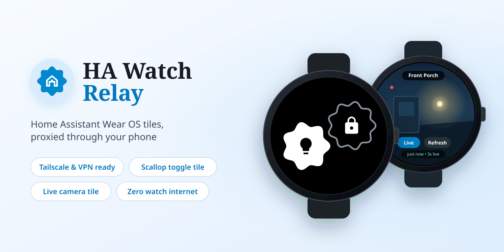

# HA Watch Relay

<p align="center">
  
</p>

An Android + Wear OS companion app that provides two Home Assistant Wear OS Tiles — a minimalist
Material 3 Expressive scalloped toggle panel and a security camera viewer — while routing **all**
Home Assistant traffic through your paired phone.

## Why phone-proxied?

The native Home Assistant Wear OS client maintains its own direct connection to Home Assistant,
which breaks when your HA server is only reachable through your phone's VPN (such as Tailscale)
while away from home.

In **HA Watch Relay**, the `:wear` module intentionally requests **no `INTERNET` permission** at
all. Every state fetch, service call, and camera snapshot happens on the Android phone app using
the phone's network stack and is relayed to the watch over the Google Play Services **Wearable
Data Layer API** (`MessageClient` + `DataClient`).

## Features

- **Minimalist Controls Tile (`ControlsTileService`)**
  - Glyph-only Material 3 Expressive scalloped buttons (up to 6 distinct lobe silhouettes) with no
    header or ON/OFF text clutter.
  - Cozy diagonal stagger for 2-button setups; balanced grids for 1–6 entities.
  - Filled white scallop when ON, outlined empty scallop when OFF — tapping fires explicit
    `turn_on` / `turn_off` calls with a rev-up gear spin, springy scale bounce, and expressive
    haptic feedback.
- **Security Camera Tile & Live Viewer (`CameraTileService` + `CameraLiveActivity`)**
  - Displays the latest downscaled snapshot from your chosen `camera.*` entity and auto-refreshes
    when the tile becomes visible or when **Refresh** is tapped.
  - Tapping the tile or **Live** opens a fullscreen Wear OS viewer that actively polls the phone
    at your configured interval (`2s`–`30s`) while the screen is on, stopping immediately when
    backgrounded to preserve battery.
- **Phone Companion App (`:mobile`)**
  - Stores your Home Assistant URL and Long-Lived Access Token with `EncryptedSharedPreferences`.
  - Built-in **QR code scanner** (via Google Play Services Code Scanner, no camera permission
    needed) to scan Home Assistant's Long-Lived Access Token QR code directly.
  - Searchable, reorderable entity picker (`switch`, `light`, `input_boolean`, `fan`, `lock`,
    `cover`, `button`, `input_button`, `script`, `scene`) and camera quality/refresh selector.
  - Background `WearableListenerService` (`WatchRelayService`) handles watch requests even when
    the phone app UI is closed.

## Project structure

- **`:shared`** — Wearable Data Layer paths, `kotlinx.serialization` message models, and
  `HaServiceMapper` (domain + state → Home Assistant service call).
- **`:mobile`** — Android companion app, OkHttp Home Assistant REST client, JPEG downscaler for
  fast Bluetooth transfer, and background `WatchRelayService`.
- **`:wear`** — Wear OS Tiles (`ControlsTileService`, `CameraTileService`), fullscreen live camera
  activity, Wear Compose app, and `PhoneDataListenerService` (no `INTERNET` permission).

## Build

```sh
./gradlew :shared:test :mobile:testDebugUnitTest   # run unit tests
./gradlew :mobile:assembleDebug                    # build phone companion APK
./gradlew :wear:assembleDebug                      # build Wear OS APK
```

Both `:mobile` and `:wear` share the same `applicationId` (`xyz.draumaz.hawidget`) and must be
signed with the same key so the Wearable Data Layer can pair them.
